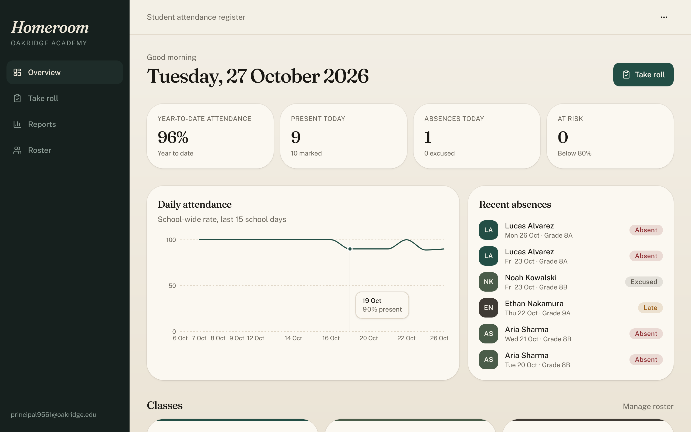
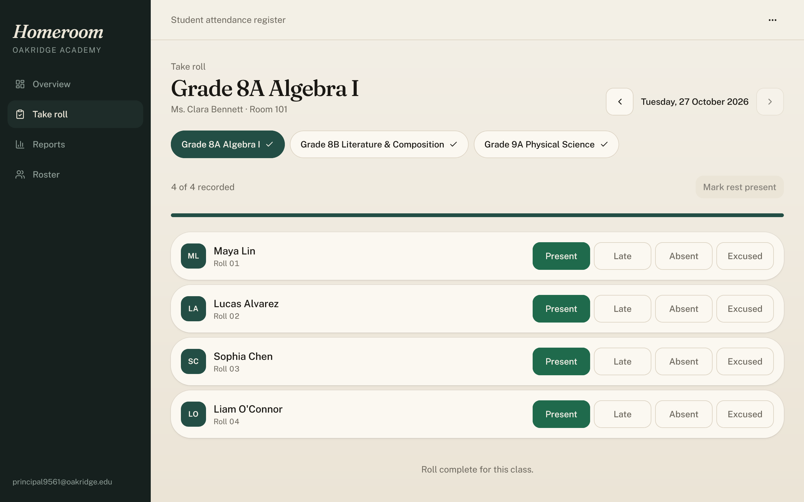
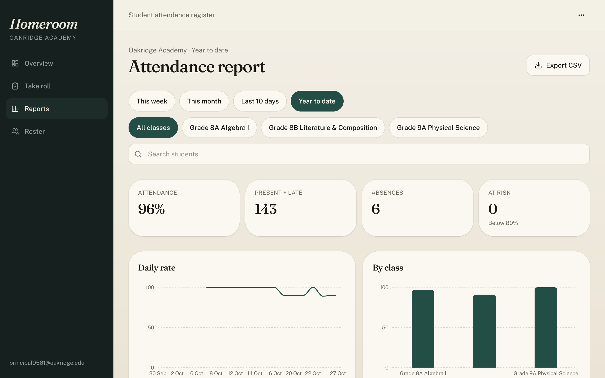
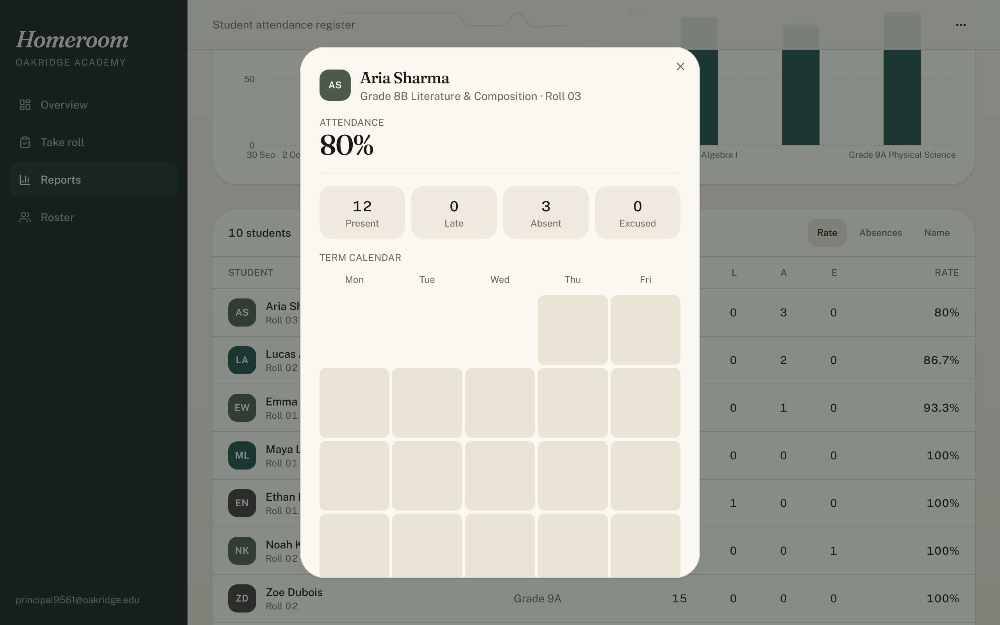

# Homeroom

Homeroom is a responsive student attendance register built with React 19, Tailwind CSS 4, and TanStack Router, backed by a Python FastAPI service with PostgreSQL persistence. Each school account features isolated classes, students, and attendance records with secure session management.

[](LICENSE)
[](https://react.dev)
[](https://fastapi.tiangolo.com)
[](https://www.python.org)

---

## Screenshots

| Overview & Daily Attendance | Roll Call Interface |
| :---: | :---: |
|  |  |

| Attendance Reports & Trends | Student Profile & Heatmap |
| :---: | :---: |
|  |  |

---

## Features

- **Multi-Tenant School Isolation**: Each school account registers independently; classes, students, and attendance records are strictly isolated at the database query level.
- **Fast Roll Call**: Interactive classroom roll call with keyboard-friendly status pickers (`Present`, `Late`, `Absent`, `Excused`), "Mark rest present", and day-clearing capabilities.
- **Roster Management**: Manage classes (name, grade, room number, teacher, accent color) and students (first name, last name, roll number) with confirmation guards on deletions.
- **Analytics & Trends**: School-wide year-to-date and daily attendance rates, absence tracking, and class comparison bar charts.
- **Student Profile & Heatmap**: Term calendar heatmaps with weekday alignment and granular attendance history.
- **CSV Data Export**: RFC 4180-compliant CSV export with formula-injection sanitization for safe spreadsheet analysis.
- **Secure Authentication**: Argon2 password hashing via `pwdlib`, HTTP-only secure cookie sessions, and per-session CSRF token validation.

---

## Tech Stack

| Layer | Technologies |
| :--- | :--- |
| **Frontend** | React 19, TypeScript, TanStack Router, TanStack Start, Tailwind CSS 4, Zustand, Lucide Icons, Recharts |
| **Backend** | Python 3.11+, FastAPI, SQLAlchemy 2.0, Pydantic 2, Pwdlib (Argon2), PyJWT |
| **Database** | PostgreSQL (production), SQLite (local development fallback) |
| **Server/Deployment** | Nitro (Vercel Build Output API v3), Uvicorn, Docker |

---

## Project Structure

```text
homeroom/
├── api/                    # Vercel serverless function entrypoints
│   ├── index.py            # ASGI handler for Vercel Python runtime
│   └── requirements.txt    # Function-level dependencies
├── backend/                # FastAPI application
│   ├── app/
│   │   └── main.py         # Routes, database models, auth, and business logic
│   ├── migrations/
│   │   └── 0001_init.sql   # PostgreSQL initial schema
│   ├── tests/
│   │   └── test_api.py     # API and security test suite
│   ├── Dockerfile          # Production container image definition
│   ├── Procfile            # PaaS process file (Render/Railway/Heroku)
│   └── requirements.txt    # Backend Python dependencies
├── docs/
│   └── screenshots/        # Application screenshots
├── public/                 # Static assets, icons, and favicon
├── scripts/                # Development, build, and screenshot automation scripts
├── src/                    # React frontend source
│   ├── components/         # UI components (charts, heatmap, modals, shell)
│   ├── lib/                # Store, stats calculation, dates, and API client
│   └── routes/             # TanStack Router page views
├── LICENSE                 # MIT License
├── package.json            # Node.js dependencies and scripts
├── requirements.txt        # Top-level Python requirements
├── tsconfig.json           # TypeScript configuration
├── vercel.json             # Vercel deployment routing and rewrites
└── vite.config.ts          # Vite & Nitro build configuration
```

---

## Quick Start (Local Development)

### Prerequisites
- **Node.js**: 22+
- **Python**: 3.11+

### 1. Start the Backend API
From the repository root:

```powershell
# Create and activate virtual environment
python -m venv backend\.venv
backend\.venv\Scripts\python -m pip install -r backend\requirements.txt

# Start FastAPI dev server (defaults to local SQLite at backend\homeroom.db)
Set-Location backend
.venv\Scripts\python -m uvicorn app.main:app --reload --host 127.0.0.1 --port 8000
```

### 2. Start the Frontend
In a separate terminal window:

```powershell
Set-Location homeroom
npm install
npm run dev
```

Visit [http://localhost:8080](http://localhost:8080) to register a school account and begin tracking attendance.

---

## Deployment

### Option A: All-in-One Vercel Deployment
Both frontend and Python serverless API deploy directly to Vercel:

1. Import the repository into your [Vercel Dashboard](https://vercel.com/new).
2. Add environment variables in **Project Settings → Environment Variables**:
   - `DATABASE_URL`: Your PostgreSQL connection string (e.g. from [Neon](https://neon.tech) or [Supabase](https://supabase.com)).
   - `SECRET_KEY`: A random string of at least 32 characters.
   - `APP_ENV`: `production`
   - `COOKIE_SECURE`: `true`
   - `COOKIE_SAMESITE`: `lax`
3. Execute the schema migration in your database console:
   - Run [`backend/migrations/0001_init.sql`](backend/migrations/0001_init.sql).
4. Deploy. Vercel routes `/api/*` to the Python serverless function and serves frontend routes via Nitro.

### Option B: Split Container Deployment
For persistent connection pools and zero cold starts:
1. Deploy `backend/` to Render, Railway, or Fly.io using [`backend/Dockerfile`](backend/Dockerfile).
2. Set backend environment variables:
   - `DATABASE_URL`, `SECRET_KEY`, `APP_ENV=production`, `COOKIE_SECURE=true`, `COOKIE_SAMESITE=none`
   - `CORS_ORIGINS`: `https://your-frontend.vercel.app`
3. Deploy the frontend to Vercel with:
   - `VITE_API_URL`: `https://your-backend-api.onrender.com`

---

## Validation & Testing

```powershell
# Backend unit & security tests
backend\.venv\Scripts\python.exe -m unittest discover -s backend\tests

# Frontend typecheck & test suite
npm run typecheck
npm test

# Production build
npm run build
```

---

## License

This project is licensed under the terms of the [MIT License](LICENSE).
